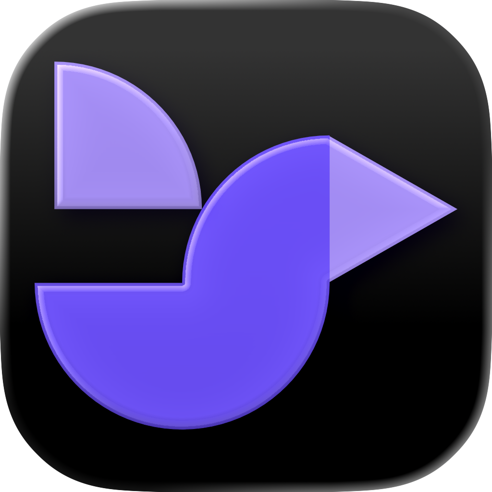

<p align="center">
  
</p>

<h1 align="center">TUFF</h1>

<p align="center">
  The local AI app built for the Mac. Runs models far bigger than your Mac's memory.
</p>

<p align="center">
  <a href="https://github.com/rexmhall09/TUFF/releases/latest">Download</a> ·
  <a href="https://rexmhall09.github.io/TUFF/">Website</a> ·
  <a href="https://rexmhall09.github.io/TUFF/benchmarks/">Benchmarks</a> ·
  <a href="CONTRIBUTING.md">Contribute</a> ·
  <a href="https://github.com/rexmhall09/TUFF/discussions">Discussions</a>
</p>


TUFF runs language models on Apple Silicon Macs. The app is SwiftUI and the
engine is my own, written in Swift and Metal. It's open source, and nothing you
type leaves your Mac unless you turn on web search.

**Qwen3.8 Flash Next is a 111 GB model, and TUFF runs it on a 16 GB MacBook
Air.** TUFF keeps a mixture-of-experts model's experts on the SSD and reads
only the few each token needs. GPT-OSS 120B and MiniMax M2.7 run the same
way. On that Air, Flash Next writes about 1.7 tokens a second; smaller models
are much faster. The [benchmarks](https://rexmhall09.github.io/TUFF/benchmarks/)
show how each model runs on real Macs.

## Install

You need an Apple Silicon Mac on macOS 15 or newer.

1. Download the ZIP from the [latest release](https://github.com/rexmhall09/TUFF/releases/latest),
   unzip it and move `TUFF.app` to Applications.
2. Open TUFF, go to **Models** and install one. Gemma 4 E2B is a quick first
   download.

TUFF isn't notarized, so the first time, Control-click the app and choose
Open. Or use Homebrew, which also adds the `tuff` command:

```sh
brew tap rexmhall09/tuff https://github.com/rexmhall09/TUFF.git
brew install --cask rexmhall09/tuff/tuff
```

TUFF updates itself. If an update stops it from opening, see
[recovery](docs/RELEASE_RECOVERY.md).

## What's in it

- **Chat** with reasoning, Markdown, math, and image and file attachments.
  Going back to a recent chat continues from where the model left off instead
  of reading the whole conversation again.
- **Web and Files search.** Off until you turn them on. The model can search
  the web or folders you pick, and cites what it used.
  [How search works](docs/SEARCH.md).
- **Benchmarks.** Measure any installed model on your Mac and share the result
  on the [leaderboard](https://rexmhall09.github.io/TUFF/benchmarks/).
  [How benchmarks work](docs/BENCHMARKS.md).
- **Background API.** A local OpenAI-compatible server for agents and other
  apps. It loads whichever installed model a request names.
  [Server and API](docs/LOCAL_SERVER.md).

| Model | Download | Minimum memory | Images |
| --- | ---: | ---: | :-: |
| Gemma 4 E2B Q4 | 2.6 GB | 8 GB | Optional |
| Gemma 4 E4B Q4 | 4.2 GB | 8 GB | Optional |
| Gemma 4 12B QAT | 11.0 GB | 16 GB | Optional |
| Gemma 4 26B-A4B Q4 | 14.3 GB | 8 GB | Optional |
| Qwen 3.6 35B-A3B Q4 | 19.6 GB | 8 GB | Optional |
| GPT-OSS 20B Q4 | 13.8 GB | 16 GB | No |
| GPT-OSS 120B Q4 | 65.3 GB | 16 GB | No |
| MiniMax M2.7 Q4 | 128.7 GB | 16 GB, M2 or newer | No |
| Qwen 3.8 Flash Next Q4 | 110.9 GB | 16 GB, M2 or newer | Optional |
| Ornith 1.5 9B Q4 | 5.1 GB | 8 GB | Optional, 16 GB |
| Ornith 1.5 35B-A3B Q4 | 19.6 GB | 8 GB | Optional, 16 GB |
| Ornith 1.5 397B Q4 | 239 GB | 16 GB | Optional |
| Qwen3.8 27B Q4 | 16.2 GB | 8 GB | Optional, 16 GB |
| Gemma 4 26B-A4B Heretic Q4 | 15.0 GB | 8 GB | Optional |

Models are grouped under **MoE**, **Dense** and **Legacy**. Each section can be
collapsed. MiniMax and both GPT-OSS models stay available under Legacy.

The app downloads an inference engine when you install its first model. Models
with compatible architectures share that engine. Auto chooses context, expert
cache and resident layers together. A dense model that does not fit can stream
layers from disk, but that can be slow. These are calculated choices; TUFF learns
from comparable runs in the app and avoids configurations that caused paging.
[Memory and engine details](docs/LOCAL_9.0.md).

[Gemma Heretic](https://huggingface.co/mlx-community/gemma-4-26B-A4B-it-heretic-4bit)
is an optional abliterated derivative, converted by mlx-community from
[coder3101's checkpoint](https://huggingface.co/coder3101/gemma-4-26B-A4B-it-heretic).
Its routed experts and attention weights are Q4; shared MLPs and routers remain
8-bit. Its image pack comes from the same checkpoint. Reduced refusals do not
mean better accuracy. The ordinary Gemma model remains available.

I test releases on a 16 GB M2 MacBook Air. Numbers for other Macs come from
people's benchmarks. Images need an M2 or newer.

## How TUFF compares

| | TUFF | [LM Studio](https://lmstudio.ai/docs/app) | [Ollama](https://ollama.com/blog/new-app) | [Colibrì](https://github.com/JustVugg/colibri) | [TurboFieldfare](https://github.com/drumih/turbo-fieldfare) |
| --- | :-: | :-: | :-: | :-: | :-: |
| Built only for Apple Silicon Macs | ✅ | ❌ | ❌ | ❌ | ✅ |
| Desktop chat app | ✅ | ✅ | ✅ | ◐ | ✅ |
| Built-in web search in chat | ✅ | ❌ | ◐ | ❌ | ❌ |
| Search your own folders from chat | ✅ | ◐ | ❌ | ❌ | ❌ |
| Local OpenAI-compatible server | ✅ | ✅ | ✅ | ✅ | ◐ |
| Command-line tools | ✅ | ✅ | ✅ | ✅ | ✅ |
| Image input | ✅ | ✅ | ✅ | ✅ | ✅ |
| Dense models | ✅ | ✅ | ✅ | ✅ | ❌ |
| Own engine, not MLX or llama.cpp | ✅ | ❌ | ❌ | ✅ | ✅ |
| Streams MoE experts from disk | ✅ | ❌ | ❌ | ✅ | ✅ |
| Open-source desktop app | ✅ | ❌ | ✅ | ✅ | ✅ |
| Windows and Linux | ❌ | ✅ | ✅ | ✅ | ❌ |
| Models | 14 | GGUF / MLX catalog | Model library | 13 engines, mostly MoE | Gemma 26B |

✅ yes · ◐ partly · ❌ no. Checked against each project's docs on October 8, 2026.

- **Web search:** TUFF uses DuckDuckGo with no account, or Brave or Tavily
  with your key. Ollama's [web search](https://docs.ollama.com/capabilities/web-search)
  is a hosted API that needs an Ollama account. LM Studio has none built in,
  but you can add it with MCP servers.
- **Folders:** LM Studio can chat with documents you attach, which covers
  some of the same ground.
- **Streaming** means a fixed-size expert cache, not OS paging or CPU
  offload. LM Studio and Ollama have much bigger model libraries.
- **Colibrì** also streams experts and runs Flash Next, on more platforms.
  **TurboFieldfare** is where TUFF started.

This compares features only. I haven't benchmarked these against each other.

## Command line

The app includes the `tuff` command:

```sh
tuff prompt "Explain mixture-of-experts models in two sentences."
tuff bench --models gemma4,qwen36 --share
tuff serve --port 8080
```

`tuff serve` runs the same server as the Background API. It only listens on
your Mac and has no authentication. [OMP setup](docs/OMP.md) is a tested
coding-agent config.

## Build from source

You need Xcode with Swift 6.2 or newer (I build with Xcode 27).

```sh
git clone https://github.com/rexmhall09/TUFF.git
cd TUFF
bash Scripts/package_engines.sh dist/local-engines dist/local-private/signing-key 1.0.0
export TUFF_ENGINE_CATALOG_PATH="$PWD/dist/local-engines/engine-catalog.json"
swift build -c release
.build/release/TUFF
```

Clone builds keep models and chats in `scratch/`, so they don't touch an
installed copy. `Scripts/test.sh` runs the tests; none need a model.
[Local 9.0 builds](docs/LOCAL_9.0.md) explains the downloaded family engines,
isolated app packaging and local qualification.
[How TUFF works](docs/HOW_TUFF_WORKS.md) explains the engine and maps the
code.

## Contributing

The easiest way to help is to run a benchmark on your Mac and share it.
There are also
[good first issues](https://github.com/rexmhall09/TUFF/issues?q=is%3Aissue%20is%3Aopen%20label%3A%22good%20first%20issue%22),
a [roadmap](docs/ROADMAP.md), and [Discussions](https://github.com/rexmhall09/TUFF/discussions)
for questions and ideas. [CONTRIBUTING.md](CONTRIBUTING.md) explains the rest.

## Credits

TUFF began as a fork of [drumih/turbo-fieldfare](https://github.com/drumih/turbo-fieldfare)
by Andrey Mikhaylov, which built the original Gemma runtime and expert
streaming. TUFF is [Apache 2.0](LICENSE). Model weights keep their own terms;
other credits are in [THIRD_PARTY_NOTICES.md](THIRD_PARTY_NOTICES.md).
Security issues go to [private reporting](SECURITY.md).
